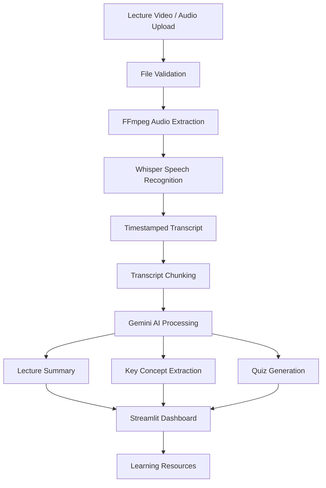

# Lecture - lens: AI-Lecture-Video-Summarisation-Platform
**An AI-powered learning assistant that transforms lecture recordings into structured, easy-to-understand learning material.**

<p align="center">

  **Neural Networks and Deep Learning Lab | Mini AI Product Development Project**

</p>

## Team Members

| Name | University Roll Number |
|---|---|
| Harshita Sharma | MCO23378 |
| Diksha | MCO23376 |

**Project ID:** MCO23378  
**Project Category:** Multimodal and Generative AI Applications  
**Project Number:** 32

---

## 1. Project Overview

Lecture AI is an AI-powered lecture video summarisation platform designed to simplify the process of learning from lengthy academic lectures.

Students often spend considerable time revisiting recorded lectures, identifying important concepts, preparing notes and creating practice questions. Lecture AI aims to automate these tasks through speech recognition, natural language processing and generative AI.

The platform accepts lecture videos or permitted audio recordings, extracts their audio content, generates a transcript and processes the lecture using AI models to produce structured learning resources.

The objective is to provide students with a single platform for lecture transcription, summarisation, concept extraction and knowledge assessment.

## 2. Key Features

The planned application includes the following capabilities:

### 2.1 Lecture Upload and Audio Processing
- Upload lecture recordings in supported video and audio formats.
- Validate file types and recording duration.
- Extract audio using FFmpeg.
- Convert audio into a standard 16 kHz mono WAV format.

### 2.2 Automatic Speech Recognition
- Generate text transcripts from lecture recordings using Whisper.
- Preserve timestamps for individual transcript segments.
- Display the generated transcript in a readable format.

### 2.3 AI-Powered Lecture Summarisation
- Generate concise summaries of lengthy lectures.
- Organise content into structured sections.
- Identify important explanations and key takeaways.
- Support chunk-based summarisation for longer transcripts.

### 2.4 Key Concept Extraction
- Identify important concepts discussed during lectures.
- Generate concise definitions based on lecture content.
- Associate extracted concepts with their corresponding timestamps.

### 2.5 Automatic Quiz Generation
- Generate multiple-choice questions from lecture transcripts.
- Provide four answer options per question.
- Include correct answers and explanations.
- Categorise questions by difficulty level.
- Ground generated questions in the lecture content.

### 2.6 Learning Material Export
- Provide structured lecture notes.
- Support downloading generated study material.

*Features are being implemented incrementally. Refer to the development status below.*

---

## 3. System Architecture

The application follows a modular architecture consisting of video processing, speech recognition, AI processing, backend services and a web-based frontend.

### Processing Workflow

1. **Input:** The student uploads a lecture video or audio recording.
2. **Audio Extraction:** FFmpeg extracts and converts the audio.
3. **Speech Recognition:** Whisper converts speech into timestamped text.
4. **Transcript Processing:** The transcript is cleaned and divided into manageable chunks.
5. **AI Processing:** Gemini processes the transcript to generate summaries, concepts and quiz questions.
6. **Output:** The application presents the generated learning resources through an interactive dashboard.

### Architecture Diagram



---

## 4. Technology Stack

| Component | Technology |
|---|---|
| Programming Language | Python |
| Frontend | Streamlit |
| Backend | FastAPI |
| Speech Recognition | Faster-Whisper |
| Generative AI | Google Gemini API |
| Audio Processing | FFmpeg |
| NLP Processing | Python, LLM-based processing |
| Data Validation | Pydantic |
| API Communication | REST API |
| Development Environment | Google Colab |
| Version Control | Git and GitHub |
| Deployment | Cloud hosting platform |

---

## 5. Project Structure

```text
AI-Lecture-Summarisation/
│
├── backend/
│   ├── __init__.py
│   ├── main.py
│   ├── audio.py
│   ├── llm.py
│   ├── prompts.py
│   └── chunking.py
│
├── frontend/
│   └── app.py
│
├── data/
│   └── sample_transcript.txt
│
├── eval/
│
├── scripts/
│   └── test_llm.py
│
├── notebooks/
│   ├── harshita_day1.ipynb
│   └── diksha_day1.ipynb
│
├── requirements.txt
├── .env.example
├── .gitignore
└── README.md
```

---

## 6. Installation and Setup

### Prerequisites

- Python 3.10 or later
- FFmpeg
- Git
- Google Gemini API key

### Step 1: Clone the repository

```bash
git clone https://github.com/YOUR-USERNAME/AI-Lecture-Summarisation.git

cd AI-Lecture-Summarisation
```

Replace `YOUR-USERNAME` with the GitHub repository owner's username.

### Step 2: Create a virtual environment

```bash
python -m venv .venv
```

Activate the environment:

**Windows:**

```bash
.venv\Scripts\activate
```

**Linux / macOS:**

```bash
source .venv/bin/activate
```

### Step 3: Install dependencies

```bash
pip install -r requirements.txt
```

### Step 4: Install FFmpeg

FFmpeg must be installed and accessible through the system PATH.

Verify installation:

```bash
ffmpeg -version
```

### Step 5: Configure Gemini API

Create a `.env` file in the project root.

```env
GEMINI_API_KEY=your_gemini_api_key
GEMINI_MODEL=gemini-2.5-flash
BACKEND_URL=http://localhost:8000
```

Use a Gemini model currently available to your API account. Never upload the actual `.env` file to GitHub.

### Step 6: Start the backend

```bash
uvicorn backend.main:app --reload
```

Backend API:

```text
http://localhost:8000
```

Interactive API documentation:

```text
http://localhost:8000/docs
```

### Step 7: Start the frontend

Open another terminal:

```bash
streamlit run frontend/app.py
```

The application will be accessible at:

```text
http://localhost:8501
```

---

## 7. API Endpoints

The backend uses FastAPI to expose the following endpoints.

| Method | Endpoint | Purpose |
|---|---|---|
| GET | `/health` | Check backend availability |
| POST | `/upload` | Upload and validate lecture media and extract audio |
| POST | `/summary` | Generate lecture summaries |
| POST | `/concepts` | Extract key concepts |
| POST | `/quiz` | Generate multiple-choice questions |

### API Documentation

FastAPI automatically provides interactive API documentation through Swagger UI at `/docs`.

**Note:** Automatic Whisper transcription will be integrated into the upload workflow in a subsequent development phase.

---

## 8. AI Processing Methodology

### Speech Recognition

Whisper will be used to convert lecture audio into text while retaining timestamp information.

### Transcript Chunking

Long transcripts are divided into smaller sections to manage input length and support structured summarisation.

The initial implementation uses fixed-size chunking, with topic-based segmentation planned for further experimentation.

### Summarisation

Two summarisation approaches will be investigated:

- **Single-Pass Summarisation:** Processes the complete transcript in one model request.
- **Chunk-Based Summarisation:** Summarises individual transcript sections and combines their outputs into a consolidated summary.

### Concept Extraction

Gemini identifies important concepts, generates transcript-grounded definitions and associates them with relevant timestamps.

### Quiz Generation

Gemini generates structured MCQs using Pydantic response schemas to validate the output format.

Questions are designed to have four options, one correct answer, an explanation and a difficulty label.

---

## 9. Testing and Evaluation

The project will be evaluated using quantitative and qualitative experiments.

| Component | Evaluation Method |
|---|---|
| Speech Recognition | Word Error Rate (WER) and processing time |
| Summarisation | ROUGE, BERTScore and human evaluation |
| Concept Extraction | Precision@K and manual relevance assessment |
| Quiz Generation | JSON validity, answer correctness and transcript grounding |
| Application | Functional testing and error handling |

### Planned Experimental Comparisons

1. Whisper tiny vs. base vs. small.
2. Single-pass vs. chunk-based summarisation.
3. Fixed-size vs. topic-based transcript segmentation.

Evaluation will use permitted lecture recordings and manually prepared reference material.

Results will be reported after experiments are completed. No performance figures are assumed in advance.

---

## 10. Development Status

The project is being developed incrementally.

| Component | Status |
|---|---|
| Project structure | Initialised |
| FastAPI backend | Initial implementation |
| Streamlit frontend | Initial implementation |
| Video/audio upload validation | Initial implementation |
| FFmpeg audio extraction | Initial implementation |
| Gemini API integration | Initial implementation; testing required |
| Fixed-size transcript chunking | Initial implementation |
| AI summarisation | Initial implementation; testing required |
| Key concept extraction | Initial implementation; testing required |
| Quiz generation | Initial implementation; testing required |
| Whisper integration | Planned |
| Timestamped transcription | Planned |
| Downloadable learning notes | Planned |
| Evaluation experiments | Planned |
| Cloud deployment | Planned |

---

## 11. Future Enhancements

Potential extensions include:

- Lecture-based question-answering using Retrieval-Augmented Generation (RAG).
- Timestamp-based navigation within lecture recordings.
- Topic-wise revision notes.
- Difficulty-based personalised quizzes.
- Downloadable PDF and DOCX study material.
- Support for multilingual lectures.
- Improved topic detection and transcript segmentation.

These features will be considered after the core application is stable.

---

## 12. Responsible AI and Data Privacy

- Only public, appropriately licensed or explicitly authorised lecture recordings will be processed.
- API keys and credentials will be stored securely using environment variables or platform secrets.
- Uploaded recordings and transcripts will not be committed to the public repository.
- AI-generated summaries and questions may contain errors and should be checked against the original lecture.
- The system is intended as an educational assistance tool and does not replace the original lecture material.

---

## 13. Team Contributions

| Team Member | Primary Responsibilities |
|---|---|
| Harshita Sharma | Video processing, audio extraction, Whisper integration, transcription pipeline and backend development |
| Diksha | Gemini integration, summarisation, key concept extraction, quiz generation and frontend development |

Both members will contribute to integration, testing, evaluation, deployment and documentation.

---

## 14. Project Information

**Project Title:** AI Lecture Video Summarisation Platform

**Course:** Neural Networks and Deep Learning Lab

**Project Type:** Multimodal and Generative AI Application

**Institution:** Chandigarh College of Engineering and Technology, Panjab University

**Academic Session:** 2026

**Repository:** [GitHub Repository](https://github.com/YOUR-USERNAME/AI-Lecture-Summarisation)

**Live Application:** To be added after deployment.

---

## Acknowledgement

This project is developed as part of the Neural Networks and Deep Learning Laboratory mini AI product development assignment. It explores the practical application of speech recognition, natural language processing and generative AI in educational technology.

**Built by Harshita Sharma and Diksha.**
